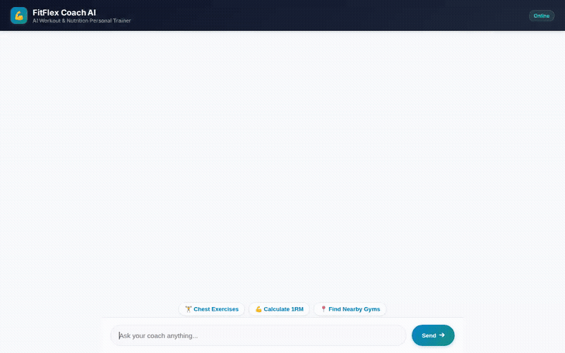

# 💪 FitFlex Coach AI

An intelligent AI personal trainer and fitness coach built with the **Google Agent Development Kit (ADK)** and deployed on **Vertex AI Agent Engine**. FitFlex Coach AI assists users with exercise discovery, strength math calculations, dietary macro planning, nutritional lookups, gym location mapping, multi-modal AI media generation, and persistent memory of user goals and dietary restrictions.



---

## 🌟 Capabilities & Tools

FitFlex Coach AI integrates custom Python tools, Google Cloud services, and Gemini models to provide an all-in-one fitness platform:

### 🏋️ 1. Exercise Library & Firestore Database
- **`list_exercises(muscle_group, equipment)`**: Queries Google Cloud Firestore to list exercises tailored to target muscle groups and available gym equipment.
- **`get_exercise_details(name)`**: Retrieves detailed exercise guides including execution steps, target muscles, and safety tips from Firestore.
- **`add_exercise(...)`**: Allows users to contribute custom exercise routines to the Firestore database.

### 🧮 2. Fitness Math & Python Code Execution
- **`calculate_fitness_metrics(weight_lifted_kg, reps, goal, bodyweight_lbs)`**: Uses ADK's `BuiltinCodeExecutor` to calculate 1-Rep Max (1RM) using standard Epley and Brzycki formulas, generates training load percentages (70%-90% 1RM), and estimates daily caloric and macronutrient targets (Protein, Carbs, Fats) based on bodyweight and fitness goals (fat loss, maintenance, muscle building).

### 🥗 3. Food & Nutrition Intelligence
- **`search_food_nutrition(query)`**: Integrates with the **Open Food Facts API** to fetch real-time nutritional metrics (calories, protein, carbohydrates, fats, ingredients) for foods and meal options.

### 📍 4. Location Mapping & Gym Discovery
- **`geocode_address(address)`**: Converts physical street addresses or city names into latitude/longitude coordinates using the **Google Maps Geocoding API**.
- **`find_nearby_places(latitude, longitude, place_type, radius)`**: Locates nearby fitness facilities, gyms, and sports clubs using the **Google Maps Places API**.

### 🎨 5. Multi-Modal AI Media Generation
- **`generate_fitness_image(prompt)`**: Generates visual meal plans and exercise form diagrams using Google's **`gemini-3.1-flash-lite-image`** model in the `global` region. Saves images to session artifacts and uploads directly to a public **Google Cloud Storage** bucket.
- **`generate_fitness_video(prompt)`**: Generates short exercise technique video demonstrations using Google's **`gemini-omni-flash-preview`** model via the Vertex AI Interactions API in the `global` region. Saves video bytes to session artifacts and streams to public Cloud Storage.

### 🧠 6. Long-Term Memory & Safety Tracking
- **Vertex AI Memory Bank (`VertexAiMemoryBankService`)**: Persists user training preferences, fitness goals, and dietary restrictions across conversations.
- **`PreloadMemoryTool`**: Automatically searches and loads relevant user memories into agent context at the start of each session.
- **Allergy & Safety Guardrails**: Enforces dietary safety rules, ensuring allergy triggers (e.g. peanuts, tree nuts, dairy, gluten, eggs) are remembered and never suggested in meal recommendations.

### 🎴 7. Adaptive Structured UI Cards
- **A2UI Schema Manager (`A2uiSchemaManager`)**: Generates structured JSON cards (Card, Column, Row, Text, Image) to present workout recommendations and metrics in a clean chat interface.

---

## 🏗️ Architecture & Cloud Infrastructure

- **Framework**: Google Agent Development Kit (`google-adk`)
- **Deployment Target**: Vertex AI Agent Engine Runtime (`us-east1`)
- **Database**: Google Cloud Firestore
- **Media Storage**: Google Cloud Storage (Public Media Bucket)
- **Generative Models**:
  - `gemini-flash-latest` (Root Reasoning Agent)
  - `gemini-3.1-flash-lite-image` (Image Generation)
  - `gemini-omni-flash-preview` (Video Generation)
- **Frontend Proxy**: FastAPI + HTML5/CSS3 chat UI deployed to Cloud Run

---

## 🛠️ Local Setup & Running

### 1. Install Dependencies
```bash
pip install -r app/requirements.txt
```

### 2. Set Environment Variables
```bash
export AGENT_ENGINE_RESOURCE_NAME="<YOUR_AGENT_ENGINE_RESOURCE_NAME>"
export AGENT_DIRECTORY="app"
```

### 3. Start Frontend Proxy Locally
```bash
cd frontend
python main.py
```
*The local development proxy will start on port `8080`.*
